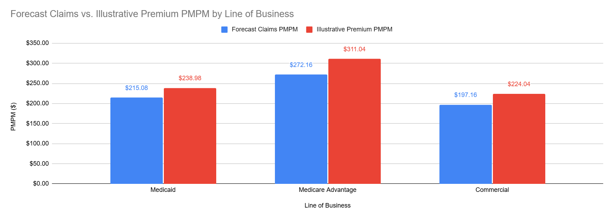
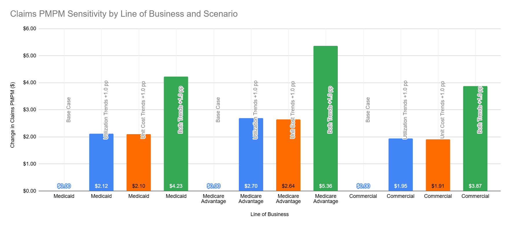
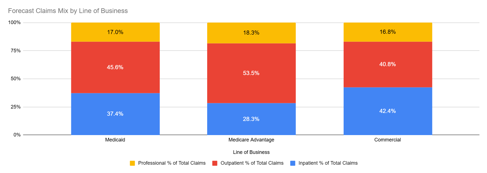

# Health Insurance Claims Forecasting & Illustrative Pricing Model

[**View the Google Sheets Workbook**](https://docs.google.com/spreadsheets/d/1BSCUklZd8xancY-QOmPxpoU6SImsUutykFuPoAQUgYA/edit?usp=sharing)

## Project Overview

This model uses illustrative synthetic health insurance claims data to demonstrate a healthcare actuarial workflow for analyzing historical claims experience, forecasting future claims costs, and calculating an illustrative premium estimate across Medicaid, Medicare Advantage, and Commercial lines of business.

The model uses 2025 historical experience to project 2026 claims costs by separately applying utilization and unit cost trend assumptions to inpatient, outpatient, and professional services.

## Data Description

The dataset contains 36 monthly records covering January through December 2025 across three lines of business: Medicaid, Medicare Advantage, and Commercial.

Each record includes member months, inpatient admissions, outpatient visits, professional visits, inpatient claims, outpatient claims, professional claims, and total claims.

All data is synthetic and illustrative. No actual member, provider, or health plan claims information is used.

## Workbook Navigation

For a guide to the workbook's structure and the purpose of each worksheet, see the **Workbook Navigation** tab.

## Methodology

The model uses 2025 historical claims experience as the baseline for forecasting 2026 claims costs.

1. **Historical Analysis:** Aggregates annual member months, utilization, and claims by line of business. Calculates historical claims PMPM, utilization PMPM, and service-category unit costs.

2. **Claims Forecast:** Applies separate utilization and unit cost trend assumptions to inpatient, outpatient, and professional services to project 2026 claims.

3. **Illustrative Pricing:** Calculates forecast Claims PMPM, illustrative Premium PMPM, annual premium revenue, and annual underwriting margin using administrative expense and profit / risk margin assumptions.

4. **Sensitivity Analysis:** Evaluates the impact of 1-percentage-point increases in utilization and unit cost trend assumptions, individually and in combination, on projected Claims PMPM and illustrative Premium PMPM. Compares the results across scenarios and lines of business to assess the relative impact of each assumption.

5. **Claims Cost Driver Analysis:** Breaks forecast claims into inpatient, outpatient, and professional categories, calculates each category's Claims PMPM and percentage contribution to total claims, and identifies the largest claims cost category for each line of business.

## Key Assumptions

The model uses illustrative assumptions that are not based on actual market experience or regulatory guidance.

- Member months are held constant at 2025 levels for the 2026 forecast.
- Separate annual utilization trend assumptions are applied to inpatient, outpatient, and professional services for each line of business.
- Separate annual unit cost trend assumptions are applied to each service category.
- Administrative expense loads and profit / risk margins vary by line of business.
- All trend, expense, and margin assumptions are illustrative and are not intended to represent market benchmarks or recommended pricing levels.

## Key Outputs

The model produces the following illustrative 2026 forecast outputs for each line of business:

- Forecast inpatient, outpatient, and professional claims
- Forecast total claims and Claims PMPM
- Illustrative Premium PMPM
- Illustrative annual premium revenue
- Illustrative annual underwriting margin
- Sensitivity analysis showing the impact of changes in utilization and unit cost trend assumptions, individually and in combination, on projected Claims PMPM and illustrative Premium PMPM
- Key findings comparing the relative impact of utilization and unit cost trend changes across all three lines of business
- Claims cost driver analysis showing service-category claims, Claims PMPM, percentage contribution to total claims, and the largest claims cost category for each line of business

## Key Visualizations

### Forecast Claims vs. Illustrative Premium PMPM by Line of Business

Compares forecast claims PMPM with illustrative premium PMPM across Medicaid, Medicare Advantage, and Commercial lines of business.

### Claims PMPM Sensitivity by Line of Business and Scenario

Illustrates the impact of changes in utilization and unit cost trend assumptions, individually and in combination, on forecast Claims PMPM across the three lines of business.

### Forecast Claims Mix by Line of Business

Shows the percentage contribution of inpatient, outpatient, and professional claims to total forecast claims for each line of business.

## Validation & Quality Checks

The workbook includes automated validation checks to confirm that:

- Historical total claims reconcile to the sum of inpatient, outpatient, and professional claims.
- Forecast total claims reconcile to the sum of forecast service-category claims.
- Forecast member months and claims are positive.
- Illustrative Premium PMPM exceeds forecast Claims PMPM.
- Illustrative underwriting margins are positive.
- Sensitivity analysis Base Case Claims PMPM and illustrative Premium PMPM reconcile to the original forecast for all three lines of business.
- All non-base sensitivity scenarios produce positive changes in Claims PMPM and illustrative Premium PMPM, and combined trend increases produce higher results than either individual trend increase or the Base Case.
- Forecast claims by service category reconcile to total forecast claims across all three lines of business.
- Service-category Claims PMPM reconciles to total Claims PMPM across all three lines of business.
- Inpatient, outpatient, and professional claims percentages sum to 100% for all three lines of business.

**All 14 automated validation checks pass.**

## Limitations

This is an illustrative modeling exercise using synthetic data and simplified assumptions. It is not a production actuarial model, rate certification, Medicare Advantage bid, or regulatory filing.

Additional limitations:

- The forecast uses only one year of historical experience (2025).
- Member months are held constant rather than forecasted.
- Trend assumptions are specified inputs, not statistically estimated from historical data.
- The model does not incorporate seasonality, membership mix changes, benefit design changes, risk adjustment, reinsurance, taxes, or other potential pricing considerations.
- Changes in member demographics and risk mix are not explicitly modeled.
- Actual pricing decisions require additional data, actuarial analysis, and review appropriate to the specific market and product.
- Claims cost driver analysis groups claims into three broad service categories and does not capture differences in service intensity, provider reimbursement, benefit design, or risk mix within each category.

## Tools

- Google Sheets
- Spreadsheet formulas and financial modeling
- Data validation and reconciliation
