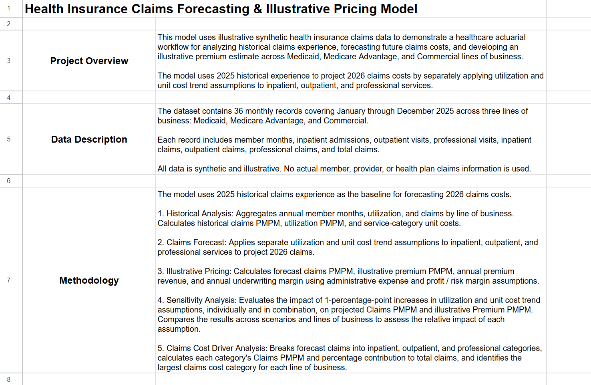
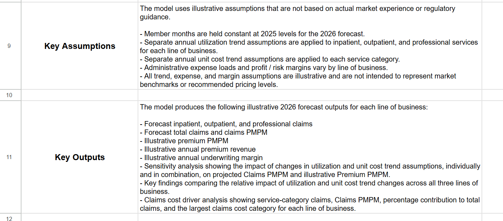
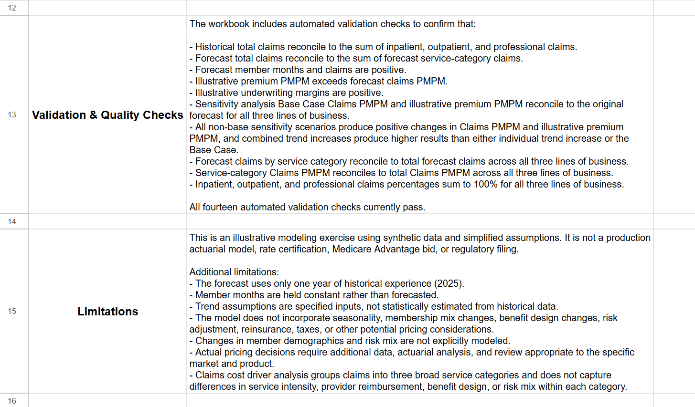

# Health Insurance Claims Forecasting & Illustrative Pricing Model

## Project Overview

This project uses synthetic health insurance claims data to analyze 2025 historical experience, forecast 2026 claims costs, and develop illustrative premium estimates across Medicaid, Medicare Advantage, and Commercial lines of business.

## Project Documentation

### Project Overview, Data Description & Methodology

### Key Assumptions & Key Outputs

### Validation & Quality Checks and Limitations

## Workbook

[Download the Excel Workbook](<Health Insurance Claims Forecasting & Illustrative Pricing Model.xlsx>)

The workbook includes:

- Historical claims experience analysis
- Claims forecasting by service category
- Illustrative premium development
- Sensitivity analysis of utilization and unit cost trends
- Claims cost driver analysis
- Automated validation and reconciliation checks

## Tools

- Google Sheets
- Excel
- Spreadsheet formulas and financial modeling
- Data validation and reconciliation

## Data & Limitations

All data is synthetic and created for illustrative purposes. Assumptions are not based on actual health plan experience or market benchmarks. This project is not an actual rate certification, Medicare Advantage bid, or production pricing model.
